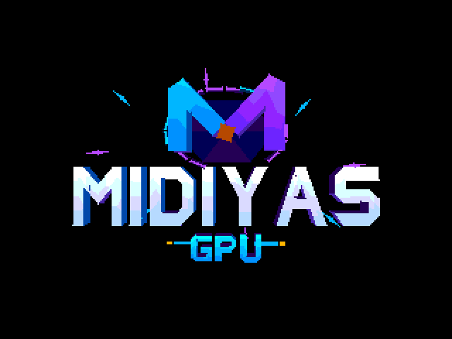
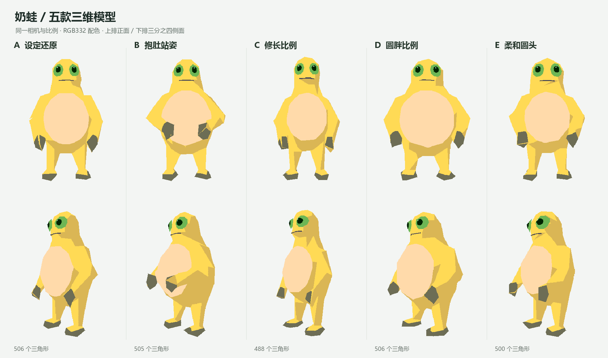
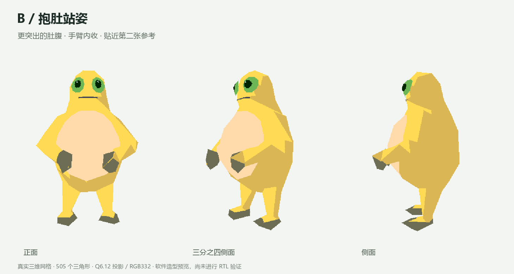

# M-GPU

完全无GPU基础，边做边学，纯老一辈手工敲代码项目。

基于 VGA 屏幕 **640×480** **RGB332**。当前上板版本以 **320×240** 渲染整幅画面，采用双缓冲，再以最近邻放大 2 倍输出到 VGA。

## 当前测试画面：MIDIYAS GPU 3D 开屏 → 奶蛙原版 B

上电播放 **MIDIYAS GPU / PRISM CORE 晶核启动**：青紫色立体双翼构成 M 徽记，中央为旋转的金色晶核；下方是冰白切面 MIDIYAS 字体、青色 GPU 字样与能量框。双翼和环带先从两侧汇聚，字母逐个转入，GPU 标签随后落位。当前入场动作放慢至原来的约 1/1.4 速度；约 4.6 秒开始向屏幕中心收拢为晶核，约 6.2 秒由同一位置展开奶蛙，并逐渐带起相机旋转，整段约 7 秒。Logo 558 个三角形分为 16 个运动组，奶蛙入场复用原模型作为第 17 组；共 420 个相位，每帧实际提交 0～300 个三角形。开头三个相位为有意保留的短黑场。

`top.v` 中 `LOGO_HOLD_MS=7000`，计时满足且第 419 相位完整显示后才进入循环旋转。最后 48 个相位用于奶蛙由小变大：第 419 相位的几何、颜色、MVP 和像素结果与普通环绕第 24 相位完全一致，随后接第 25 相位，避免突然切换或重复回到正面。`CPU_RESETN` 复位会重播开屏；`BTNU` 暂停／继续，暂停也会冻结开屏计时。设置 `LOGO_HOLD_MS=0` 可跳过开屏，并从 `START_FRAME` 指定的相位开始奶蛙旋转。两段动画均为 40 MHz、目标 60 FPS。上述 GIF 按当前 320×240 RGB332 像素放大生成，包含约 7 秒开屏和后续约 1 秒环绕，循环仅用于预览；硬件开屏只在上电或复位时播放。

Logo 生成器为 `tools/midiyas_logo.py`，`python tools/build_vertex_lab.py` 会一起生成开屏与当前奶蛙的顶层 ROM。几何顶点只存一份，每个三角形通过 5 位组号选择本相位的 MVP，实现字母、双翼、晶核和环带独立运动。7268 个矩阵槽去重后存为 4636 项，矩阵地址为 13 位；绘制顺序按每帧起始偏移紧凑存储，共 121782 项，避免动画加长造成 ROM 浪费。奶蛙入场复用原来的 505 条三角形命令。场景只在 GPU 完成写回后的 HOLD 状态切换，空相位直接提交已清屏的后缓冲。GPU 核心、VGA、时钟模块和约束文件未因本次转场修改。

当前使用五款候选中的原版 B：抱肚站姿、突出的肚腹、内收手臂，以及接近平直、嘴角轻微下收的嘴线。完整模型共 505 个三角形，顶点为 18 位 signed Q6.12，颜色为 RGB332。当前使用的网格、OBJ 和材质文件与 `assets/milk_frog_variants/B/` 完全一致。这是适合当前 GPU 的低多边形三维复刻，并非原始角色模型。

相机绕模型水平旋转，128 个相位，半径 5.4，中心 `(0,0,5.4)`；当前约 59.98 FPS，每圈约 2.13 秒。每个视角预先进行背面剔除和遮挡排序，实际绘制 160～291 个三角形，最多为第 5 相位。几何顶点只存一份，每帧切换 MVP 矩阵、绘制索引和有效三角形数量；合并开屏后共 1063 个三角形，索引和数量使用 11 位，548 组绘制顺序与有效数量的场景地址为 10 位。奶蛙模型、普通环绕矩阵和排序与原版 B 完全一致，仅增加一次入场变换。不同颜色的深度冲突仍会报错；GPU 没有 Z-buffer，该离线排序仅针对固定模型和预设相机运动。光照明暗预先写入顶点颜色。

GPU 时钟保持 **40 MHz**，`TARGET_FPS=60`，目标周期约 16.67 ms。当前 VGA 为 25 MHz 像素时钟、800×521 总时序，每 16.672 ms 刷新一次，因此实际显示上限约 **59.98 FPS**。新开屏全部 420 个相位的保守工作量上界最大为 12.7043 ms，低于刷新周期。奶蛙普通环绕数据保持上一版不变。GPU 只清屏、写入后缓冲；整帧完成后，`top.v` 通过 `PRESENT → SWAP_WAIT` 提交显示请求，VGA 在垂直消隐开始时交换，GPU 收到跨时钟确认后才能清屏、绘制下一帧。双缓冲和核心 RTL 保持不变。

`top.v` 的 `H_RES=320`、`V_RES=240` 同时传入 GPU 和三个顶点着色器。每份 framebuffer 为 76,800 字节，两份合计 150 KiB，颜色仍为 RGB332。VGA 时序仍为 640×480，使用 `(scan_y/2)*320 + scan_x/2` 读取，每个渲染像素显示为 2×2 像素。整个 framebuffer 都用于绘制，没有裁剪存储范围。

- 最新比特流：`out/prism_intro_7s_transition/nexys_a7_100t_prism_intro_7s_transition.bit`，2026-10-06 生成，尚未上板实测。SHA256：`e88fefc7b8657e53d6eb6bf35c25d0f8c5e76e84b1e10d326d4fe4c363232d7b`。同目录保留构建脚本、源文件快照、全部相位开销估算、真实 RTL 连续帧日志、像素对比结果及资源、时序报告。
- 最新实现占用：LUT 27,996 / 63,400（44.16%）、寄存器 4,400 / 126,800（3.47%）、BRAM 115 / 135（85.19%）、DSP 97 / 240（40.42%）。WNS +1.046 ns、WHS +0.031 ns，全部已设置时序约束通过；DRC 无错误和 Critical Warning，24,244 条可布线网络全部完成。矩阵去重和绘制顺序紧凑存储使动画加长后 BRAM 占用保持不变，双 framebuffer 仍为 48 个 RAMB36。
- 上一版 5 秒晶核开屏比特流保留在 `out/prism_intro_5s_60fps/`，SHA256：`df1c340b7bed4ef073c161ef560907ce4272ff803e402e7ff256aa1a40d2222e`。
- 本次 RTL 像素检查覆盖开屏相位 0～3、152～153、240～241、350～351、371～373、395～396、417～419，以及从 418 连续交接到普通相位 25、26，共 22 帧，每帧 76,800 个像素完全一致；真实 trace 的屏幕显示和前后跳转也与快照一致。抽测中清屏加绘制最大 5.514 ms，换帧间隔全部为 16.672 ms。两组控制测试分别覆盖提前到时仍播放全部 420 相位、末帧保持至计时结束，并检查暂停恢复、完整帧切换、复位重播及奶蛙 128 相位回绕。`LOGO_HOLD_MS=7000` 对应 280,000,000 个 40 MHz 周期。除 top.v 外的 10 个硬件 RTL 文件未改。
- 历史居中字标比特流保留在 `out/centered_logo_5s_60fps/`，SHA256：`d21d0e770b64ebdc658c187bde5266ee9f81cb48c85944f646ce70d4f60e7014`。
- 上一版 15 FPS 双缓冲比特流保留在 `out/double_buffer_320x240_40mhz_15fps/`，SHA256：`c5664604e1a2123f0b25336ed0a79b6df51b526b1b260757654f0567abeb9114`。
- 本次双缓冲测试使用真实 40/100 MHz GPU/VGA，覆盖开屏相位 419、奶蛙相位 25 和 26 的完整绘制、垂直消隐交换、读取正确缓冲、暂停恢复、清屏和等待交换期间复位、时钟失锁恢复。前三个空开屏相位另由控制测试与逐像素测试覆盖。VGA 时序和 2 倍放大保持不变；生成器同步保留双缓冲状态机及分辨率参数。GUI 8 项和 trace 9 项独立测试通过。
- 旧版单缓冲比特流：`out/midiyas_gpu_boot_10s/build_40mhz_15fps/nexys_a7_100t_midiyas_gpu_boot_10s_40mhz_15fps.bit`。SHA256：`a74eb35d1ff16e6a2f1e87facf85d659093911208a9ce782150b3d2abafb480c`，仅作为历史版本保留。
- 旧版单缓冲 Vivado 2025.1 实现占用：LUT 14,143 / 63,400（22.31%）、寄存器 4,383 / 126,800（3.46%）、BRAM 87.5 / 135（64.81%）、DSP 95 / 240（39.58%）、MMCM 1。整体 WNS +0.738 ns、WHS +0.021 ns，GPU 域建立时间余量 +1.503 ns；全部已设置时序约束通过，17,675 条可布线网络全部完成，布线错误为零，DRC 仅有 190 项 DSP 流水线优化提示。
- 此前 10 秒开屏版本的验证日志保留在 `out/midiyas_gpu_boot_10s/`。当前控制测试为 `MGPU.srcs/sim_1/new/midiyas_boot_tb.v`。
- GUI 可选择“MIDIYAS GPU 开屏（420 帧）”“奶蛙环绕（128 帧）”或“奶蛙（单帧）”。奶蛙单独仿真和 Studio 图片注入会跳过开屏。普通仿真使用 40 MHz、目标 60 FPS；加速仿真使用 50 MHz 并取消帧率等待，仅用于功能验证。`top_tb.v` 与当前硬件统一为 320×240 双缓冲，运行脚本从 `top.v` 读取分辨率；GUI 和 PNG 最近邻放大至 640×480。
- 运行 `python tools/view_framebuffer.py` 打开回放。“屏幕显示”按实际缓冲交换显示完整帧，后台清屏和绘制不会出现在屏幕上；“绘制过程”查看后缓冲，支持慢放、1000 ms/s、拖动时间轴、前后三角形与单三角形查看。新版 trace 记录缓冲编号和交换时刻，仍支持旧版单缓冲 trace 与 640×480 HEX。320×240 HEX 默认导出 2 倍 PNG，添加 `--scale 1` 可保存原尺寸。Image Studio 保留 640×480 布局坐标，按 320×240 像素划分三角形并核对实际仿真结果，支持全彩和透明通道。用法见 [Studio 工作流](docs/studio_top_workflow.md)。
- 显示脚本适配验证：Logo 一帧、奶蛙连续两帧均逐像素匹配参考；真实 trace 的屏幕视图在交换前保持完整旧帧，前后拖动正确。透明图片与非黑背景的 76,800 个像素匹配真实 GPU；GUI、旧格式、8193 个三角形、空场景和取消测试通过。此次只调整仿真与显示工具，硬件 RTL 和已有比特流保持不变。
- 三维模型位于 `assets/milk_frog/milk_frog.obj`，材质文件为同目录 `milk_frog.mtl`；`milk_frog_model.zip` 包含模型、材质及 GPU 使用的 `mesh.json`。
- 直接运行 `python tools/build_vertex_lab.py`，可从当前保存的原版 B 网格重新生成 `top.v`。需要恢复该模型时，将 `assets/milk_frog_variants/B/` 中的 `mesh.json`、`milk_frog.obj` 和 `milk_frog.mtl` 复制至 `assets/milk_frog/` 后，再生成 RTL。制作候选造型可运行 `python tools/build_milk_frog_variants.py`，另需 `scikit-image` 和 `fast-simplification`，可安装到 `out/mesh_libs`。当前模型不使用细化生成器的 `--install` 命令。
- `docs/images/milk_frog_reference.gif` 是当前 320×240、完整 128 相位的定点参考渲染预览，按约 60 FPS 放大显示；GIF 预览不能替代上板测试。

### 奶蛙造型选择与细化

新增五份独立三维候选模型，保存于 `assets/milk_frog_variants/A` 至 `E`，每份包含 `mesh.json`、OBJ 和 RGB332 材质。A 为设定还原，B 为抱肚站姿，C 为修长比例，D 为圆胖比例，E 为柔和圆头。五款嘴线均接近平直，嘴角轻微下收。

当前选择原版 B，已恢复其原始 505 面网格并完成硬件构建。原版三视图在 `docs/images/milk_frog_variants/B_views.png`；造型预览使用软件深度测试，实际 RTL 截图见本节上方。细化尝试的网格、预览和构建结果保留在 `assets/milk_frog_variants/B_refined/`、`docs/images/milk_frog_variants/B_refined/` 与 `out/milk_frog_b/`，仅作为历史记录。

原 A～E 候选保留，运行 `python tools/build_milk_frog_variants.py` 可重新生成五款候选及预览，依赖与现有奶蛙生成器相同。此次替换前的细化模型与文档图片备份在 `out/milk_frog_b_original/previous_refined/`。本次恢复模型并重新生成顶层 ROM，保持 40 MHz、15 FPS；GPU 核心文件的构建前后校验一致。

 

## **已经做的**

- **ver1.0 基于纯FSM的Rasterize和直接写Frame buffer**

<figure align="center">

<figcaption>
<small>
测试光栅化与颜色插值 (python脚本直接读，无上板)
</small>
</figcaption>

</figure>

  

- **ver1.1 分离Rasterizer出来到rasterizer.v**

<figure align="center">

<figcaption>
<small>
再见了一坨中间变量>0<
</small>
</figcaption>

</figure>

  

- **ver1.2 加入RAST-SHAD-FIFO衔接两模块**

<figure align="center">

<figcaption>
<small>
GPT生成的testbench
</small>
</figcaption>

</figure>

 

- **ver1.3 加入VGA模块与可控制顶层top.v**
  
<figure align="center">

<figcaption>
<small>
上VGA！
</small>
</figcaption>

</figure>

 

- **ver1.4 加入Vertex Shader**
  
<figure align="center">

<figcaption>
<small>
上VGA！
</small>
</figcaption>

</figure>

 

## **将要做的**

- ~~做一个Fragment FIFO。~~

- 做一个Fragment Shader

- 引入Depth

- ~~做一个Vertex Shader~~

- ~~做一个VGA模块，上板收敛时序~~
  
 

## **目标做的**

**用C命令CPU命令GPU渲染一个3D旋转Cube在VGA屏幕上转圈圈！！！**

   

