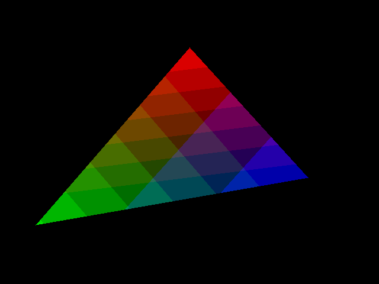
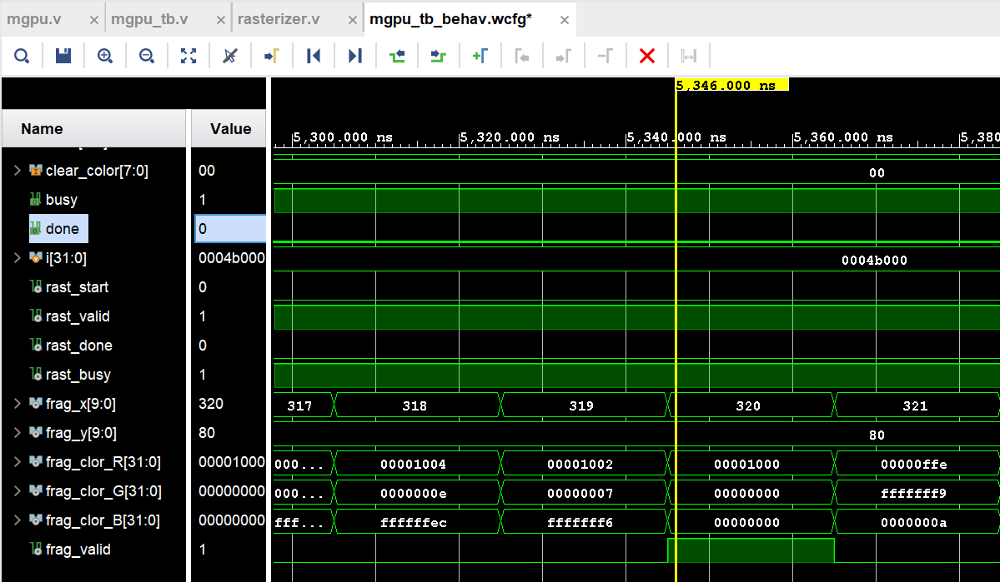
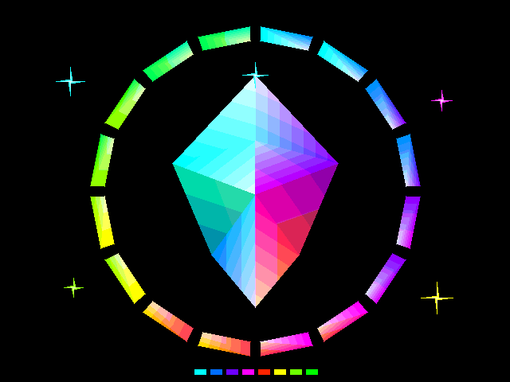
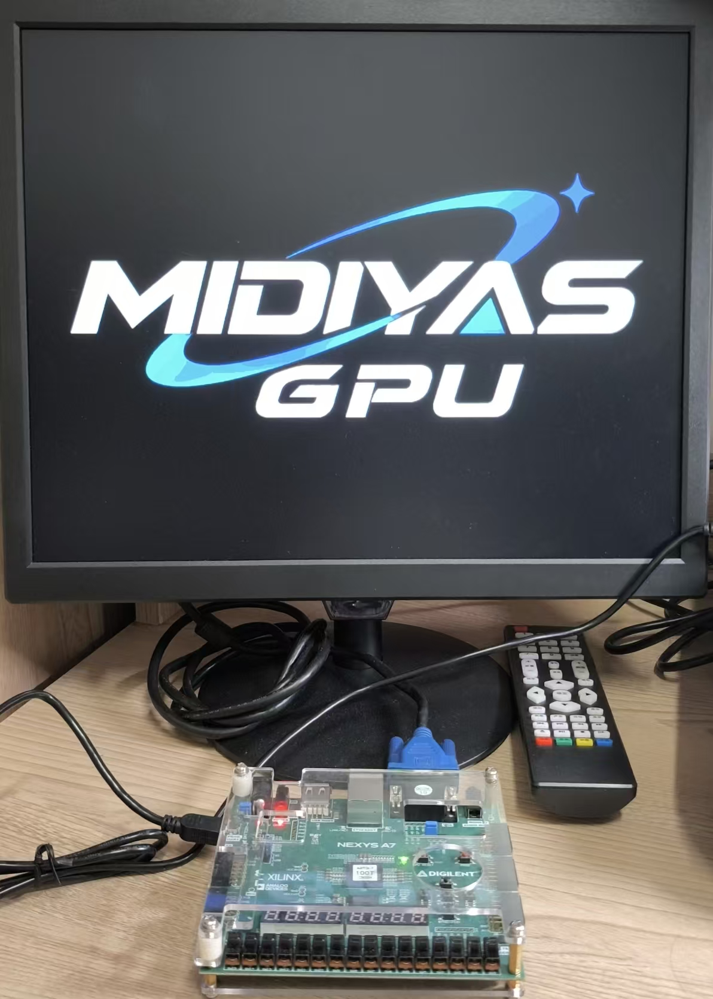
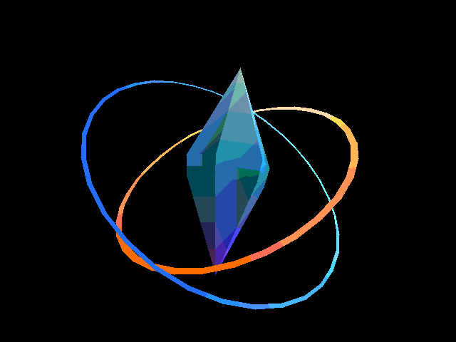
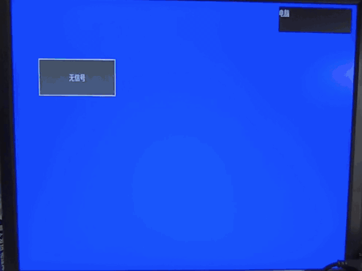
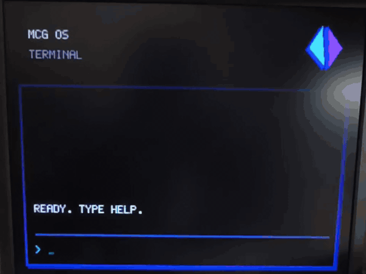
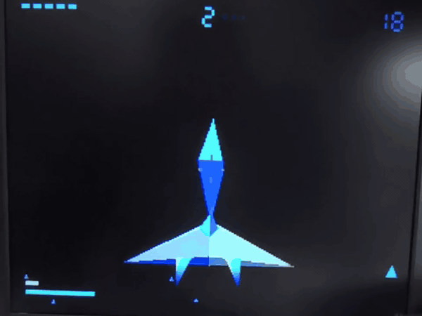
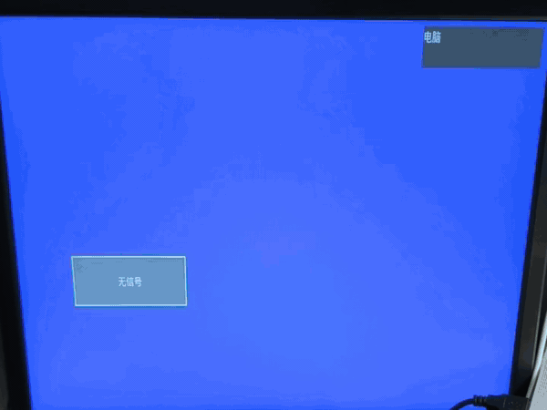

# M-GPU

当前 FPGA 顶层为 `top`：MIDIYAS GPU 开屏 → 机械晶核动画，320×240 RGB332 双缓冲，VGA 输出 640×480。GPU 40 MHz，VGA 时钟域 100 MHz。

奶蛙动画提供 **两个同等优先级、并列维护的正式版本**。两版都使用用户提供的 `milkfrog.blend`、同一 `milkfrog_top` 和 MGPU 核心，以离线绘制顺序实现无 Z-buffer 渲染；编号用于区分镜头方案。

| 正式版本 | 镜头与用途 | 交付文件 | 重建流程 |
| --- | --- | --- | --- |
| **V1 · 固定镜头** | 对照原片的完整大笑动作 | [视频、比特流与报告](deliverables/milkfrog/v1_fixed/README.md) | [V1 工作流](docs/milkfrog_workflow.md) |
| **V2 · 360° 环绕镜头** | 同一完整动作的全周观察 | [视频、比特流与报告](deliverables/milkfrog/v2_orbit/README.md) | [V2 工作流](docs/milkfrog_orbit_v2.md) |

| V1 · 固定镜头实际 RTL | V2 · 环绕镜头实际 RTL |
| --- | --- |
|  |  |

统一入口为 [奶蛙版本索引](deliverables/milkfrog/README.md)，模型与 ROM 分类见 [资产目录](assets/milkfrog/README.md)。每版独立保存模型、ROM、视频、比特流和验证报告；共享原始模型、参考资料与工具。完整仿真帧、编译缓存和 Vivado 中间文件写入忽略的 `out/`。

- [工程结构、保留文件与清理说明](docs/project_structure.md)
- [仿真、Studio 与图片上板导出](docs/studio_top_workflow.md)
- [板级接口与构建](docs/vga.md)
- [代码风格](CODING_STYLE.md)

```powershell
python -m pip install -r requirements.txt
python tools/run_tests.py --python
python tools/view_framebuffer.py
```

以下为项目历史展示，保留所引用图片。

## **已经做的**

- **ver1.0 基于纯FSM的Rasterize和直接写Frame buffer**

<figure align="center">



<figcaption>
<small>
测试光栅化与颜色插值 (python脚本直接读，无上板)
</small>
</figcaption>

</figure>


<br><br>


- **ver1.1 分离Rasterizer出来到rasterizer.sv**

<figure align="center">



<figcaption>
<small>
再见了一坨中间变量>0<
</small>
</figcaption>

</figure>


<br><br>

- **ver1.2 加入RAST-SHAD-FIFO衔接两模块**

<figure align="center">



<figcaption>
<small>
GPT生成的testbench
</small>
</figcaption>

</figure>


<br>


- **ver1.3 加入VGA模块与可控制顶层top.sv**
  
<figure align="center">



<figcaption>
<small>
上VGA！
</small>
</figcaption>

</figure>

<br>

- **ver1.4 加入Vertex Shader**
  
<figure align="center">



<figcaption>
<small>
上VGA！
</small>
</figcaption>

</figure>

<br>

- **ver1.5 CPU × GPU × 自制 RTOS**

让 CPU 与 GPU 在自制 RTOS 下协同工作。

<figure align="center">



<figcaption><small>MCG OS 开屏</small></figcaption>

</figure>

<figure align="center">



<figcaption><small>终端与空战游戏</small></figcaption>

</figure>

<figure align="center">



<figcaption><small>ORBIT 自由飞行</small></figcaption>

</figure>

<figure align="center">



<figcaption><small>MIDIYAS GPU 与奶龙</small></figcaption>

</figure>

<br>

## **将要做的**

- ~~做一个Fragment FIFO。~~

- 做一个Fragment Shader

- 引入Depth

- 引入并行机制 

- ~~做一个Vertex Shader~~

- ~~做一个VGA模块，上板收敛时序~~
  
<br>

## **目标做的**

~~**用C命令CPU命令GPU渲染一个3D旋转Cube在VGA屏幕上转圈圈！！！**~~

<br><br><br>


